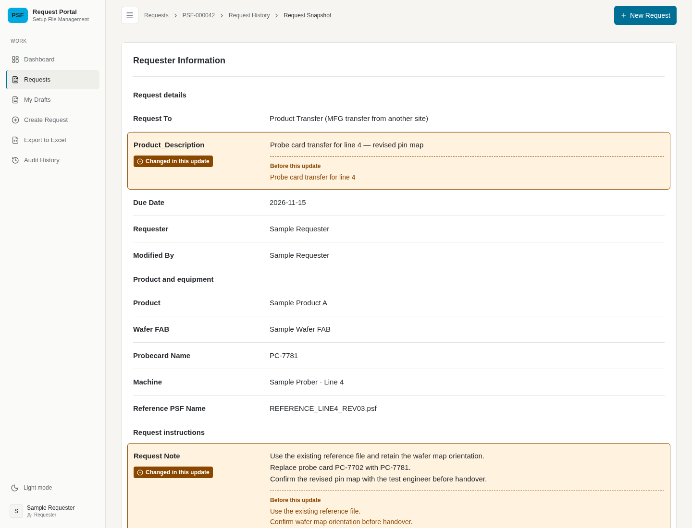
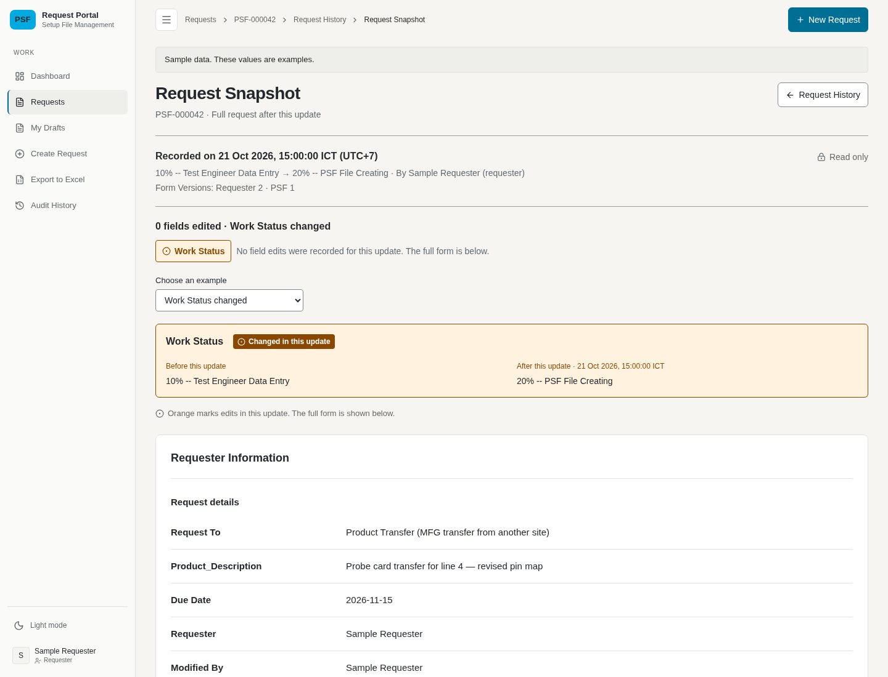

# Request Snapshot: selected layout A

This archive is the source for the selected design. It is a development prototype, not the production implementation. It was captured on 21 October 2026 for another cloud session to continue the work.

Implementation ticket: [#103](https://github.com/Kasidet4531/Web-Request-setup-file/issues/103). The user approved publishing these prototype files and screenshots to the public repository on 22 October 2026.

## Decisions

The main task is to read the complete PSF Request immediately after a selected Audit History update. Use the Detail-style layout: labels on the left, values on the right, separate Requester Information and PSF Created Information panels, with Work Status and the recorded context above.

Edited rows use an orange background and outline, an icon, the label "Changed in this update", and an explicitly labelled earlier value. The change summary links to the edited fields. A Status-change update shows the complete stored Status before and after the update. A Status-only update leaves form rows unmarked.

The user chose A and removed comparison with the current request. These decisions supersede earlier exploration of layout B and current-value comparison.

## References

- [Design decisions and verification limits](../../design/2026-10-21-request-snapshot-prototype.md)
- [Primary-source UX research](../../design/2026-10-21-request-snapshot-readability-research.md)
- [Project design and colours](../../../.stitch/DESIGN.md)
- [Existing Request Snapshot contract](../../adr/0016-full-request-snapshot-per-audit-history-entry.md)

## View the design

[Field-edit example](A-fields.png) · [Status-change example](A-status.png)

For the portable generic sample, download `index.html` and open it in a browser. It has no external assets or API connection. The sample selector offers a field-edit event and a Status-change event, and the theme button switches light and dark mode. GitHub's file viewer shows HTML source rather than running the page.

For the in-app sample, run `npm ci` and `npm run prototype:snapshot` from `frontend`. On the machine running Vite, open `/requests/prototype/history/entry-1?variant=A` on port 5174; the Status example is `status-1`. A remote cloud session needs its own supported forwarded URL. The middleware handles all sample `/api` traffic and rejects writes, without connecting to the real database.

## Handoff to the implementer

Work from the latest main baseline and use this archived branch as a reference. Implement the chosen design on the ordinary Request Snapshot route using the existing historical read contract and access rules. Keep synthetic fixtures, the example selector, the development-only variant route and this archive out of the production implementation. Review the reusable decisions rather than merging the prototype branch wholesale.

Preserve field order, full multiline values, blanks, historical Form Versions, removed-field context, existing loading/retry states and restrictions on unreleased PSF Created Information. Do not introduce a comparison fetch or current-value columns. The API's existing current-status breadcrumb metadata is separate from the removed comparison feature.

The final A-only prototype passed the frontend production build, targeted ESLint and whitespace checks in its source session. Two screenshots were captured in Chromium at 1440 by 1100 in the source cloud session. The final revision did not run an automated interaction suite, a usability study or a full accessibility audit. Direct local-file opening was blocked by that environment's browser policy; it must not be claimed as verified. Earlier measurements and checks have their limits recorded in the design guide.

Suggested repository skills for the next agent: `/implement`, then `/code-review`. Use the implementation issue as the acceptance criteria and this archive as design evidence.
