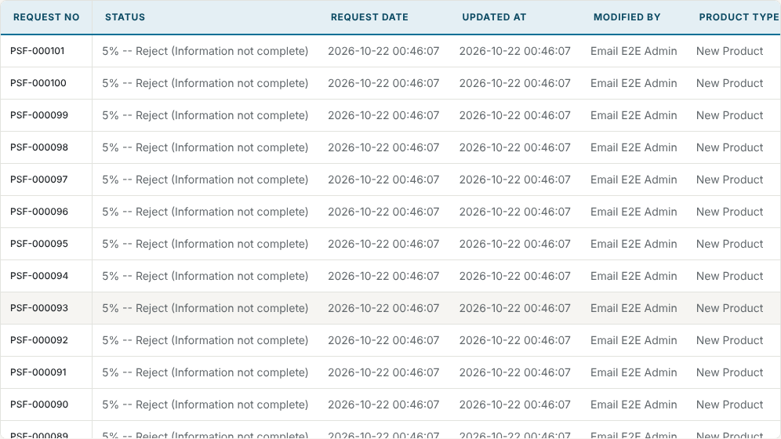

# Export dates in Bangkok time verification — 21 October 2026

## Change and environment

Fook found Request Date and Updated At hard to read in the Excel export and
the Export Preview: both showed UTC ISO timestamps such as
`2025-09-01T03:42:29.000Z`.

- Both columns now read `2025-09-01 10:42:29`: the same moment in
  Asia/Bangkok, year first so the columns still sort as text. The
  [export table](../../backend/src/export/export-table.ts) builds them for the
  file, the preview and an Export Job alike; the export filename uses the
  same [Bangkok formatter](../../backend/src/export/bangkok-time.ts).
- The request list's Updated column and Audit History already show these
  times in Asia/Bangkok from the same stored value, so the export now agrees
  with them.
- They stay text cells. [ADR 0013](../adr/0013-excel-export-schema-alignment.md)
  asked for Excel Date cells without the time; that was never built, and
  this change keeps the time Fook's example showed.
- Built on PR #100 head `0b4a3d4`. Synthetic requests only.

## Results

| Check | Command | Result |
| --- | --- | --- |
| Workbook cells | `cd backend && npx jest src/export/excel_export.columns.spec.ts` | before: fails, the cells read `2025-09-01T03:42:29.000Z` and `2025-09-01T20:05:00.000Z`; after: `2025-09-01 10:42:29` and `2025-09-02 03:05:00` (the second crosses midnight) |
| Every cell at scale | as the `postgres` user, `node --require ts-node/register scripts/verify-export-scale.ts --sizes=780,5570 --output-dir=/tmp/psf-scale` | strict cell acceptance passed for admin, setup_owner and requester at 780 and 5,570 requests, each cell checked against the fixture's own UTC+7 arithmetic; logical hashes `2d977a0…` (780) and `34eb515…` (5,570), the same for every role, changed from `06a03bb…` and `90e3eb2…` by these two columns |
| Preview in the app | `node --test test/export-preview-system.e2e.mjs` (built backend and frontend, Chromium) | the newest request's Request Date and Updated At cells equal its API `createdAt` and `updatedAt` plus 7 hours, `YYYY-MM-DD HH:mm:ss` |
| Backend suites | `npx jest`, `npm run test:e2e`, `node --require ts-node/register --test test/*.postgres.test.ts` | 755, 21, and 110 passed with 1 skipped (configured server only) |

## Not verified

Fook's database and backend. `psf_requests` stores these times as
`TIMESTAMP` without a time zone, so the moment shown depends on the backend
and the database session using the same time zone, as the request list
already does. With the backend in Asia/Bangkok, an imported request shows
the Created/Modified value its SharePoint sheet held.
