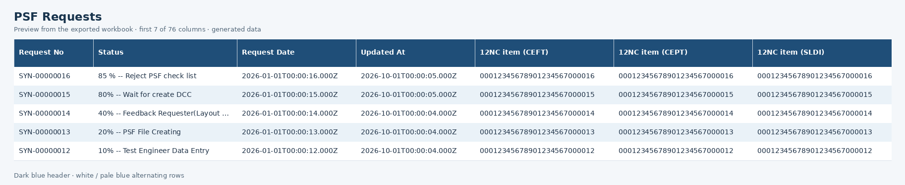

# Readable Excel export

The `PSF Requests` worksheet now has a dark blue header (`#1F4E78`) with bold white text and alternating white / pale blue (`#EAF2F8`) data rows. Header text wraps in a 32-point row. Columns have bounded widths; status, dates and 12NC identifiers have enough room for common values without converting or shortening the stored values.

Only the workbook presentation changes. Request queries, schema mappings, column order, cell values/types, PSF visibility and queue behavior retain the existing implementation. Both synchronous and queued exports use the same workbook builder.

ExcelJS styles are enabled and the builder reuses three style objects: header, white row and blue row. The generated workbook has four cell style definitions including the default, even at 100,000 requests. This avoids creating a separate style definition for each of the 7.6 million cells.

## Evidence

- Build, ESLint and the 64 existing export tests pass; the tests include all three roles through synchronous/queued paths.
- The actual compiled service/worker generated files with 16, 5,570 and 100,000 requests. The independent ZIP/SAX oracle checked 1,292, 423,396 and 7,600,076 logical cells respectively, with zero value/type/CRLF differences.
- The 5,570/100,000 logical value/type digests match the corresponding pre-formatting application files exactly. The large formatting probe uses Admin; role-dependent contents remain covered by the existing three-role regression tests.
- ExcelJS reloads the small file and confirms the header fill/font, alternating fills including the last column, header height and bounded column widths.
- A single writer-only before/after pair using the same 100,000 fixture objects measured 11.80 → 12.89 seconds (about 9% more) and 43,473,093 → 45,250,102 bytes (about 4% more). These timings exclude PostgreSQL, HTTP and worker handoff; they are not new end-to-end application timings. The complete styled service/worker probe without a database took 16.35 seconds.

[Machine results and source hash](2026-10-21-export-formatting-results.json). [Download the 16-request example](2026-10-21-export-format-preview.xlsx).

The image previews the exported values/colors; it is not a screenshot from Microsoft Excel. The downloadable workbook contains all 76 columns and the actual Excel styles. Generated data only; no real request database was accessed.
