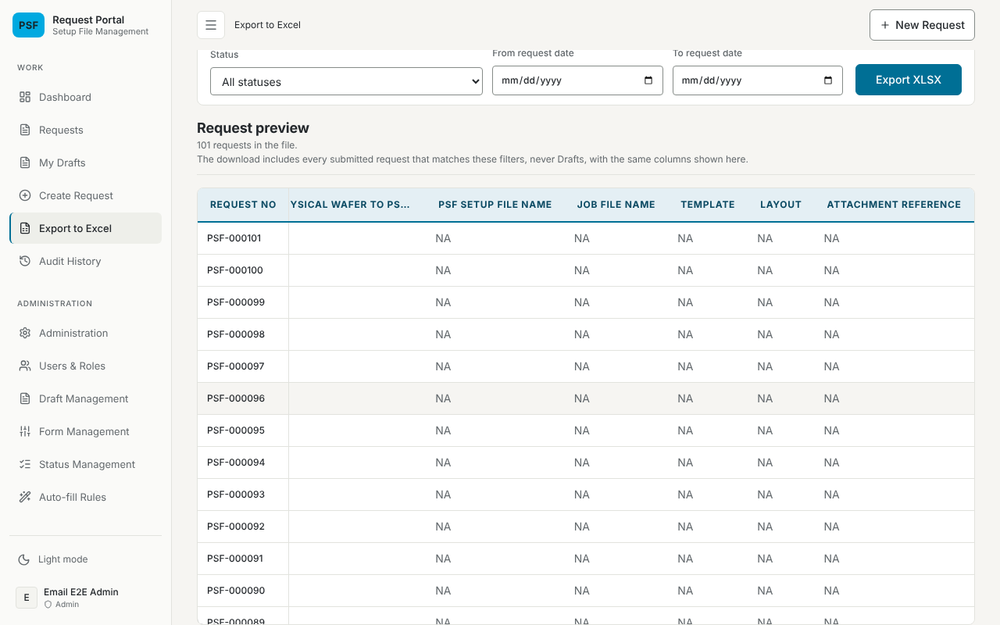
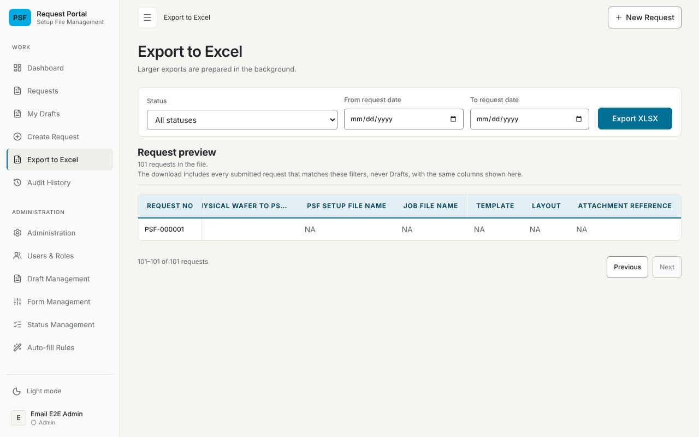

# Export Preview scrolling and pages verification — 21 October 2026

## Change and environment

Fook found, testing PR #100, that the Export Preview table could not be
scrolled sideways, so the columns past the window could not be seen, and
that it showed only 10 rows; Fook asked for Next, as on `/requests`.

- `.request-export__preview .data-table` had `overflow: hidden` in
  [`ux-polish.css`](../../frontend/src/ux-polish.css), from when the preview
  had five columns. It overrode `overflow-x: auto`, so the columns past the
  window were cut off. The table now scrolls both ways inside the window
  (at most `min(70vh, 720px)` tall, so its sideways scrollbar stays in
  reach with 100 rows), with the header row and Request No pinned.
- The preview shows the file 100 rows a page, as the request list does:
  "1–100 of N requests", Previous and Next. A page stays in place, back at
  its top, while the next one loads; changing a filter returns to the first
  page; an empty or failed page keeps Previous.
- `GET /api/requests/export-preview` takes `offset` and `limit` (whole
  numbers, `limit` at most 100) and returns them with the page. A page past
  the end still returns the file's total.
- Built on PR #100 head `4fcd2f1`. The browser test runs the built backend and
  frontend in Chromium with a throwaway embedded PostgreSQL and the seeded
  forms (so not Fook's 77 columns).

## Results

| Check | Command | Result |
| --- | --- | --- |
| Sideways scroll and pages in the app | `cd backend && npm run build && npm --prefix ../frontend run build`, then as the `postgres` user `node --test test/export-preview-system.e2e.mjs` | before the CSS change, with paging already built: fails, the last column has viewport ratio 0 after a sideways wheel over the table; after: passes. 101 submitted requests at 1280×800: the table is shorter than the window, a sideways wheel brings the last column into view with Request No still showing, the page itself never scrolls sideways, the header row stays in view at the page's last row, "1–100 of 101 requests", Next shows the oldest request alone as "101–101 of 101 requests" with Next disabled, the old page stays at its top while the next one loads, Previous returns, and a filter change returns to page 1 |
| Pages match the file | `node --require ts-node/register --test test/export-columns.postgres.test.ts` | 13 requests: the first page is the whole file; pages of 5 at offsets 5, 10 and 15 hold the file's rows 6–10, 11–13 and none, each with the file's headers and total 13 (offset 15 returned total 0 before the past-the-end count) |
| Preview component and client | `cd frontend && npx vitest run` | 534 passed: the client sends `offset` and `limit=100` and rejects a response without them; the footer's range and disabled buttons at the first, middle and last pages; rows kept while loading; "0 requests" and Previous on an empty or failed page; only the count line is a live status |
| Controller | `cd backend && npx jest src/export` | 82 passed, including `offset`/`limit` passed through and `-1`, `1.5`, `0`, `ten` refused with 400 |
| Backend suites | `npx jest`, `npm run test:e2e`, PGlite suites | 754, 21, and 112 passed with 1 skipped (configured server only) |

On the simulated 25 ms, 24 Mbit/s link of the
[export transfer record](2026-10-21-export-transfer.md), a 100-row preview
page of 5,570 requests took 0.53–0.61 s (0.20–0.21 s for the page, 391 KB
from PostgreSQL), against 0.41–0.53 s for 10 rows.

## Not verified

Fook's browser, mouse and screen size, and Fook's database with its 77
columns. Each page is read in its own snapshot, so a request saved between
two pages can move between them, as on the request list.
