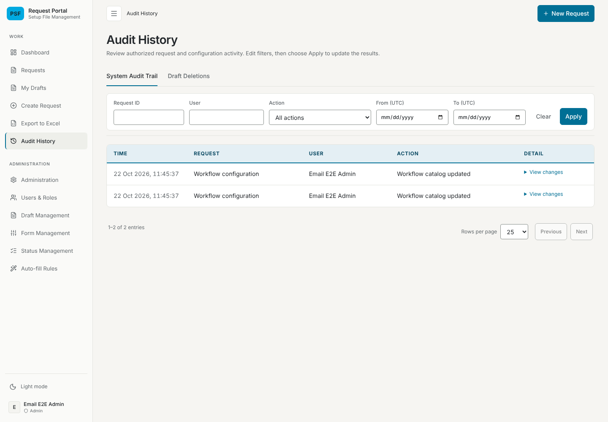
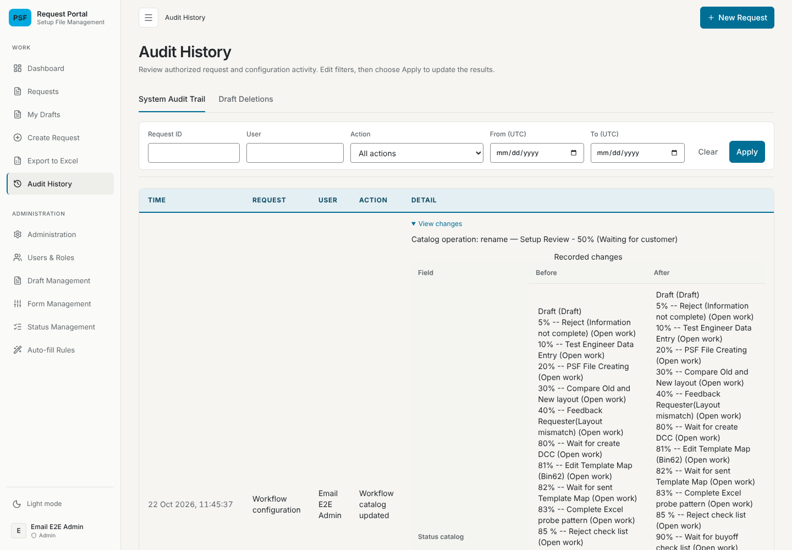
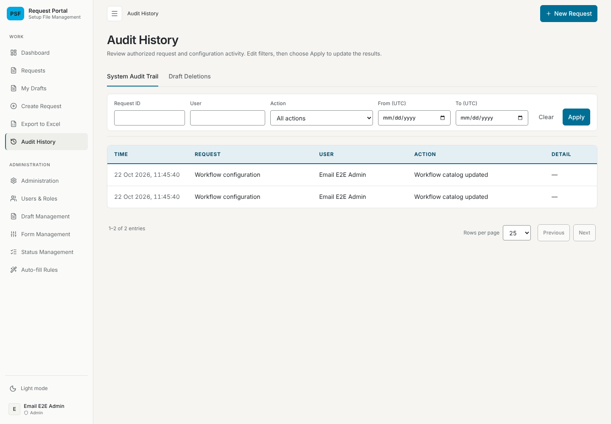

# Workflow catalog entries in Audit History verification — 22 October 2026

## Change and environment

Issue #106: on the Audit History page (`/history`) an entry with the action
"Workflow catalog updated" shows "—" in its Detail column instead of a
"View changes" toggle. Only `HistoryChanges`, its tests and the documentation
changed; the backend still records the same metadata and the API still returns
it.

- Branch `claude/project-thread-bogu9x`, based on `main` at `6cb6bd5`.
- Node 22.22.0. Browser: Chromium 141.0.7390.37 (`/opt/pw-browsers/chromium`),
  driven by Playwright 1.58.2 from `backend/node_modules`, headless, at a
  1440×1000 viewport.
- Database: a throwaway embedded PostgreSQL started by
  `backend/test/email-system.fixture.mjs` for each run and deleted afterwards.
  The configured/shared database was not used. The two catalog entries are
  synthetic: an Admin created the status `Setup Review`, then renamed it to
  `Setup Review - 50% (Waiting for customer)` and made it a PSF trigger, through
  the API.
- Backend and frontend: the compiled builds of this branch ("after") and of
  `6cb6bd5` ("before"). Company LDAP and SOAP were not contacted. External font
  requests are blocked by the fixture, so screenshots use fallback fonts.

## Test results

| Check | Command | Result |
| --- | --- | --- |
| Frontend tests | `cd frontend && npx vitest run` | 39 files, 541 tests passed |
| Frontend type check | `cd frontend && npx tsc -b` | Passed |
| Frontend lint (changed files) | `cd frontend && npx eslint src/components/ui/HistoryChanges.tsx src/components/GlobalHistoryPage.test.tsx` | 1 error, present on the base: `GlobalHistoryPage.test.tsx` `no-useless-assignment` in the Draft Deletions tab test |
| Backend unit tests | `cd backend && npx jest` | 50 suites, 755 tests passed |
| Backend API e2e | `cd backend && npm run test:e2e` | 21 passed |
| Backend PGlite suites | `cd backend && node --require ts-node/register --test test/*.postgres.test.ts` | 110 passed, 0 failed, 1 skipped |
| Browser check | A scratch `node:test` file (outside the repository) using the fixture above, run as the `postgres` user | Before: 2 "View changes" toggles on the page. After: 0 |

The Audit History tests check that a catalog row with an operation, the
Status catalog before and after and a released request count renders
`Workflow configuration`, the actor, `Workflow catalog updated` and `—`, with no
"View changes", status name or release text; and that a bulk Status replacement
entry (no Request Snapshot) still shows "View changes" with its Work Status row
and escapes the status name. The existing Request Snapshot and Attachment row
tests are unchanged and pass. Two `HistoryChanges` tests that covered catalog
rendering (PSF trigger names, hidden internal identifiers) were removed with
that rendering.

## Screenshots

Before, closed: each catalog row has a "View changes" toggle.

Before, opened: the operation and the whole Status catalog before and after
widen the Detail column and squeeze the other columns.

After: the Detail column shows "—".

## Not covered

- The configured database, company LDAP and any deployment.
- A catalog entry with a released request count in the browser: no request was
  at the new trigger status, so the old toggle had no release line to show. The
  unit test covers that metadata.
- Dark mode and mobile widths: no CSS changed.
