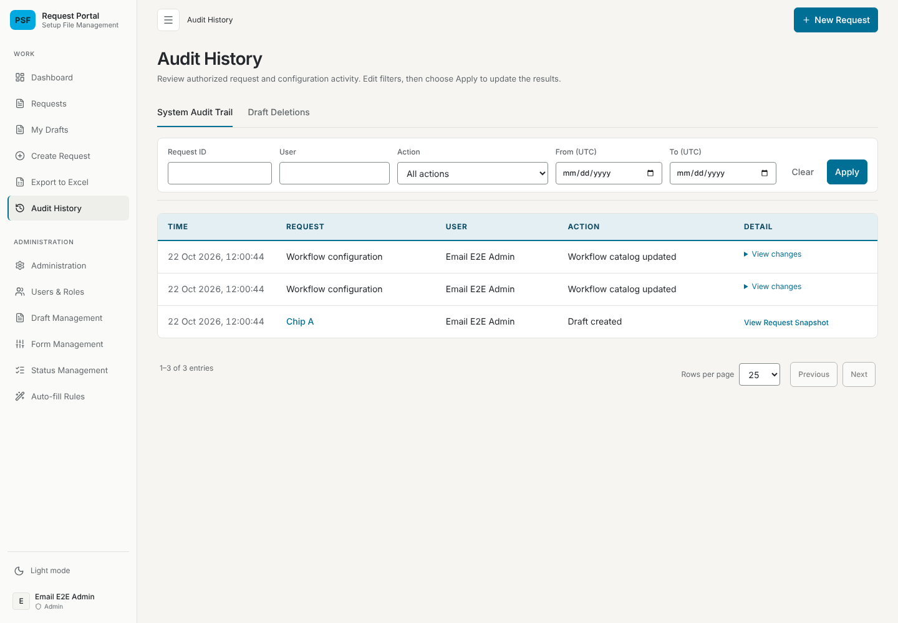
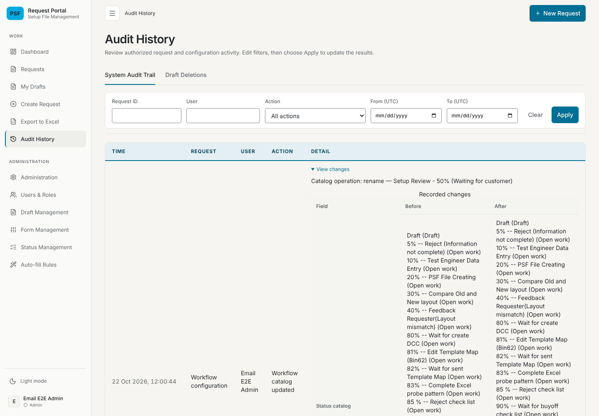
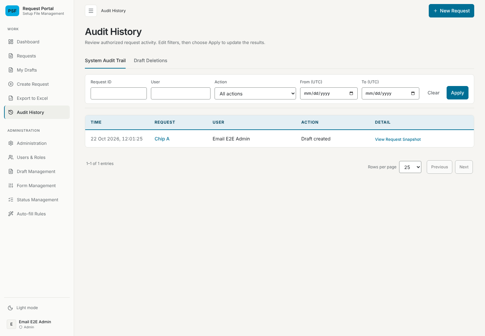

# Workflow catalog updates left out of Audit History verification — 22 October 2026

## Change and environment

Issue #106: the Audit History page (`/history`) no longer lists entries with the
action "Workflow catalog updated", and its Action filter no longer offers that
action. `GET /api/audit-logs` leaves them out of both the rows and the total for
every role, even when the action filter asks for them. The entries are still
recorded in `psf_request_audit_logs` with the same metadata (the product owner
chose to keep recording them). `HistoryChanges` no longer renders catalog
metadata, which no page receives now, and the page subtitle no longer mentions
configuration activity.

The issue first asked for a "—" in the Detail column instead of the
"View changes" toggle; the product owner then asked to remove these entries from
the page altogether.

- Branch `claude/project-thread-bogu9x`, based on `main` at `6cb6bd5`.
- Node 22.22.0. Browser: Chromium 141.0.7390.37 (`/opt/pw-browsers/chromium`),
  driven by Playwright 1.58.2 from `backend/node_modules`, headless, at a
  1440×1000 viewport.
- Database: a throwaway embedded PostgreSQL started by
  `backend/test/email-system.fixture.mjs` for each run and deleted afterwards.
  The configured/shared database was not used. The data is synthetic, created
  through the API by the Admin: a Draft titled `Chip A`, then the status
  `Setup Review`, then a rename of it to
  `Setup Review - 50% (Waiting for customer)` that also made it a PSF trigger.
- Backend and frontend: the compiled builds of this branch ("after") and of
  `6cb6bd5` ("before"). Company LDAP and SOAP were not contacted. External font
  requests are blocked by the fixture, so screenshots use fallback fonts.

## Test results

| Check | Command | Result |
| --- | --- | --- |
| Frontend tests | `cd frontend && npx vitest run` | 39 files, 540 tests passed |
| Frontend type check | `cd frontend && npx tsc -b` | Passed |
| Frontend lint (changed files) | `cd frontend && npx eslint src/components/GlobalHistoryPage.tsx src/components/GlobalHistoryPage.test.tsx` | 1 error, present on the base: `GlobalHistoryPage.test.tsx` `no-useless-assignment` in the Draft Deletions tab test |
| Backend unit tests | `cd backend && npx jest` | 50 suites, 755 tests passed |
| Backend API e2e | `cd backend && npm run test:e2e` | 21 passed |
| Backend PGlite suites | `cd backend && node --require ts-node/register --test test/*.postgres.test.ts` | 111 passed, 0 failed, 1 skipped |
| Browser check | A scratch `node:test` file (outside the repository) using the fixture above, run as the `postgres` user | See below |

`test/audit-visibility.postgres.test.ts` runs the real SQL on PGlite. For
Requester, Setup Owner and Admin the list holds no catalog entry and the total
equals the rows returned; with the action filter set to
`WORKFLOW_CATALOG_UPDATED` an Admin gets no rows and a total of 0. These failed
before the backend change. The Audit History page tests check that the Action
filter has no "Workflow catalog updated" option, and that a bulk Status
replacement entry (no Request Snapshot) still shows "View changes" with its Work
Status row and escapes the status name.

Browser check, same steps on both builds:

| | Before | After |
| --- | --- | --- |
| Entries listed (footer) | 3 (Draft created and 2 catalog updates) | 1 (Draft created) |
| "View changes" toggles | 2 | 0 |
| "Workflow catalog updated" in the Action filter | Yes | No |

## Screenshots

Before, closed: each catalog update is listed with a "View changes" toggle.

Before, opened: the operation and the whole Status catalog before and after
widen the Detail column and squeeze the other columns.

After: only the Draft entry is listed.

## Not covered

- The configured database, company LDAP and any deployment.
- Reading the kept catalog entries back from the database: the recording code
  did not change, and its existing unit and API e2e tests pass.
- Dark mode and mobile widths: no CSS changed.
