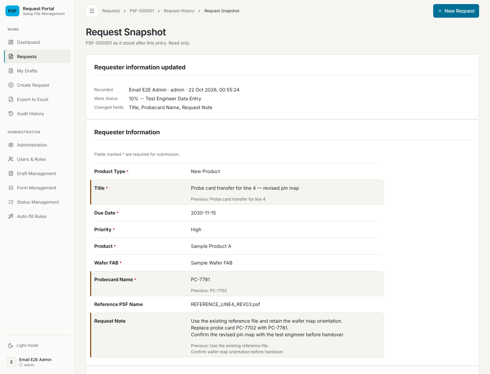
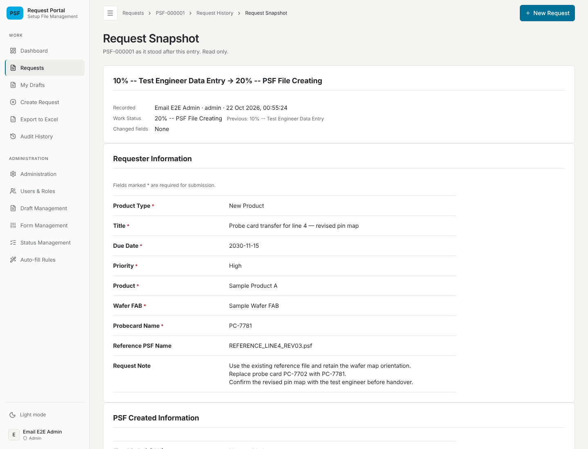
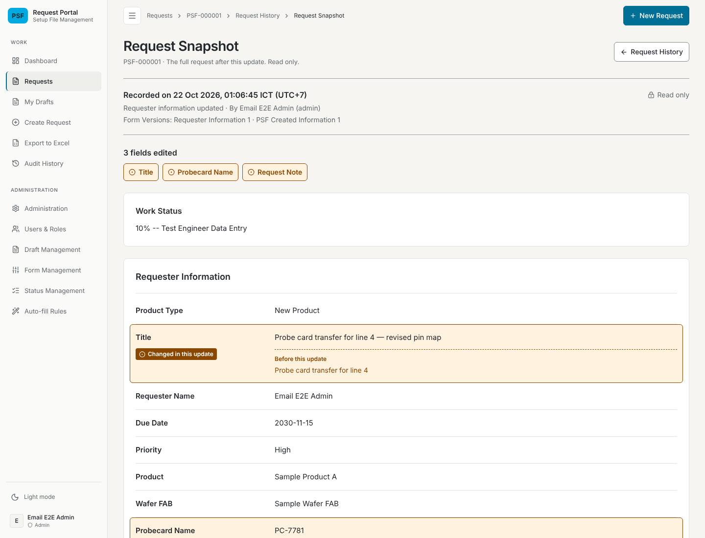
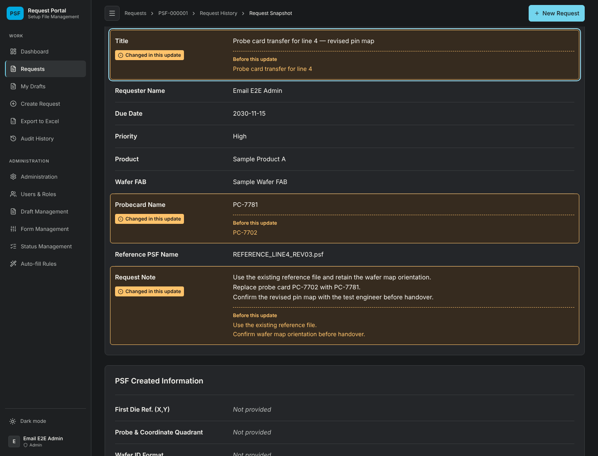
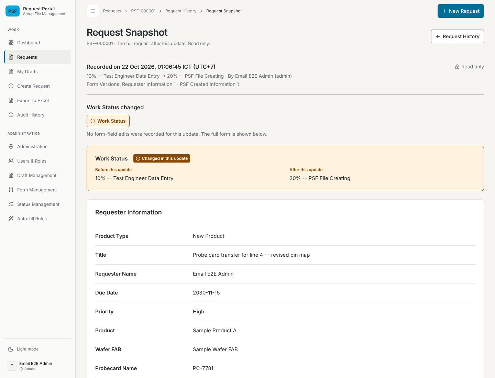
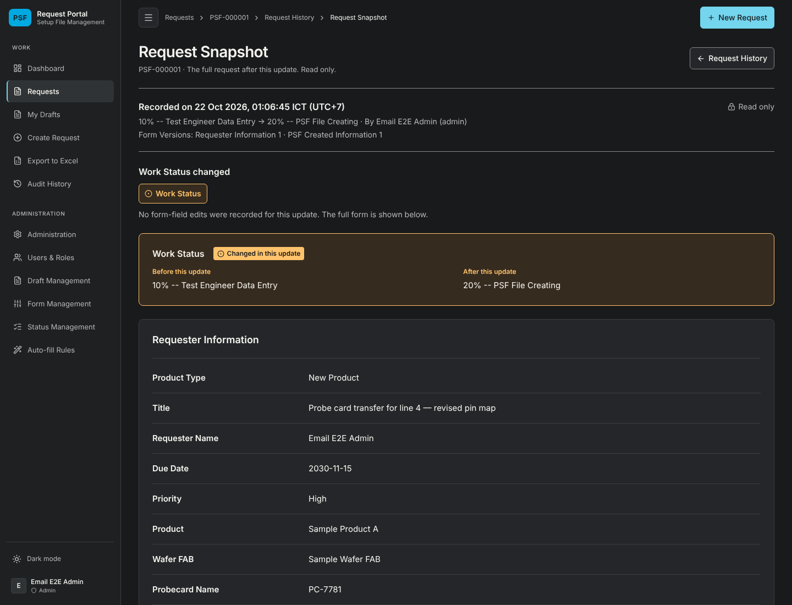

# Request Snapshot reading layout verification — 22 October 2026

## Change and environment

Issue #103: the Request Snapshot page (`/requests/$requestId/history/$entryId`)
uses layout A from the archived
[prototype branch](https://github.com/Kasidet4531/Web-Request-setup-file/tree/prototype/request-snapshot-a-2026-10-21)
on the ordinary route, with real historical reads. Only the frontend page, its
stylesheet, its tests and the browser system test changed; the backend read
contract and access rules are unchanged. The prototype's synthetic fixture,
sample selector, variant parameter and sample API middleware are not part of
this change.

- Branch `claude/project-thread-1trxhp`, based on `main` at `e6dae03`.
- Node 22.22.0. Browser: Chromium 141.0.7390.37 (`/opt/pw-browsers/chromium`),
  driven by Playwright 1.58.2 from `backend/node_modules`, headless, at a
  1440×1100 viewport.
- Database: a throwaway embedded PostgreSQL started by
  `backend/test/email-system.fixture.mjs` for each run and deleted afterwards.
  The configured/shared database was not used. The request in the screenshots
  is synthetic: created, submitted, given PSF Created Information, edited and
  moved from `10% -- Test Engineer Data Entry` to `20% -- PSF File Creating`
  through the API.
- Backend and frontend: the compiled builds of this branch ("after") and of
  `e6dae03` ("before"). Company LDAP and SOAP were not contacted. External font
  requests are blocked by the fixture, so screenshots use fallback fonts.

## Test results

| Check | Command | Result |
| --- | --- | --- |
| Frontend tests | `cd frontend && npx vitest run` | 39 files, 537 tests passed (base: 531) |
| Request Snapshot tests | `cd frontend && npx vitest run src/components/RequestSnapshotPage.test.tsx` | 16 passed |
| Frontend type check | `cd frontend && npx tsc -b --force` | Passed |
| Frontend lint | `cd frontend && npx eslint .` | 1 error, present on the base: `GlobalHistoryPage.test.tsx:389` `no-useless-assignment` |
| Frontend build | `cd frontend && npm run build` | Passed |
| Backend unit tests | `cd backend && npm test` | 49 suites, 744 tests passed |
| Backend API e2e | `cd backend && npm run test:e2e` | 21 passed |
| Backend node:test suites | `cd backend && node --require ts-node/register --test test/*.test.ts` (as the `postgres` user) | 110 passed, 1 skipped (needs the configured PostgreSQL server) |
| Browser system test | `node --test test/request-snapshot-system.e2e.mjs` (as the `postgres` user) | Every step passed; the after-hook fails on two 503 responses from attachment storage, exactly as on the base (see below) |

The Request Snapshot tests cover: full historical values in Form Schema order
with identity fields, blank and multiline values; a requester edit marked with
its earlier value; the edit count and jump links; a PSF Created Information
edit whose field key collides with a requester field; a Draft creation entry
(every value set, earlier value "Not provided"); an entry with no edits (no
change links); a Status change with both complete names and an unmarked form;
a Work Status with no recorded earlier Status; fields removed by a Form Version
upgrade, counted as removed; a lone section named like its form (no repeated
heading); PSF Created Information that
the reader may not see (no values, Form Version or edits); the recorded context;
request identity and the Request History link while loading and once loaded;
that the page never fetches the current request; loading, failure and Retry.

`DynamicFormRenderer`'s `previousValues` prop, used only by the old Request
Snapshot page, was removed with its test and CSS; the other renderer tests are
unchanged.

The browser system test opens a Request Snapshot from the request's History tab
and from Audit History on the normal route. It checks the edited Title row is the
only marked row, with "Before this update" and its earlier value; the identity
field Requester Name is shown; no "Previous:" or current-request text appears;
the summary link moves focus to the edited row; both Request History links point
to the request's history; and the submitted entry shows `Draft` before and the
submitted Status after. Its after-hook asserts no browser console errors. On
the base and on this branch alike the Request Detail page gets two 503 responses
from attachment storage, because the fixture starts the backend without
`ATTACHMENT_STORAGE_PATH`; that pre-existing failure is not caused by this change.

## Measured contrast

Colours were read with `getComputedStyle` on a marked row in the running app,
then the WCAG 2.x contrast ratio was computed from them.

| Pair | Light | Dark |
| --- | --- | --- |
| Badge text on badge | 7.04:1 | 11.03:1 |
| Value on marked row | 13.44:1 | 12.42:1 |
| Earlier value on marked row | 6.38:1 | 8.72:1 |
| Jump link text on its background | 6.38:1 | 8.72:1 |
| Row outline vs marked row | 6.38:1 | 8.72:1 |
| Row outline vs panel | 7.04:1 | 9.59:1 |

Marked row background: light `#fff2df`, dark `#362b1f`; outline and ink: light
`#8a4700`, dark `#ffc36b`; badge text: light `#ffffff`, dark `#181a1c`.

## Screenshots

Before (`e6dae03`), the same requester edit and Status change:

After, a requester edit of three fields (light), and after following the Title
link (dark, the row has keyboard focus):

After, the Status-only update in light and dark:

## Limits

The server fills in Modified By on a Status change and on a PSF Created
Information save without recording it in the entry's `fieldChanges`, so a
Request Snapshot of such an update shows the new Modified By unmarked. Marking
it would need the backend to record that change; this ticket did not change the
backend.

These checks ran on a throwaway local database with synthetic data. They are
not deployment acceptance, a usability study or a full accessibility audit.
Phone widths are outside the design scope; below 600px the label sits above its
value, which was not screenshotted.
